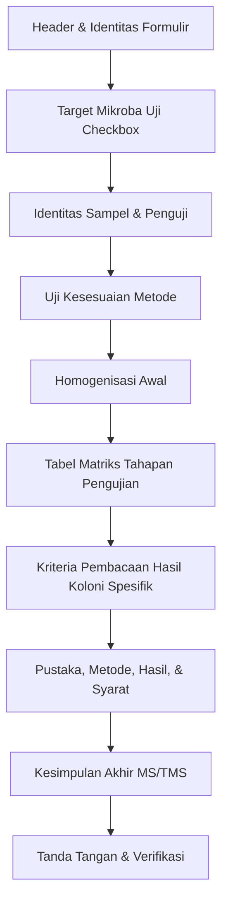
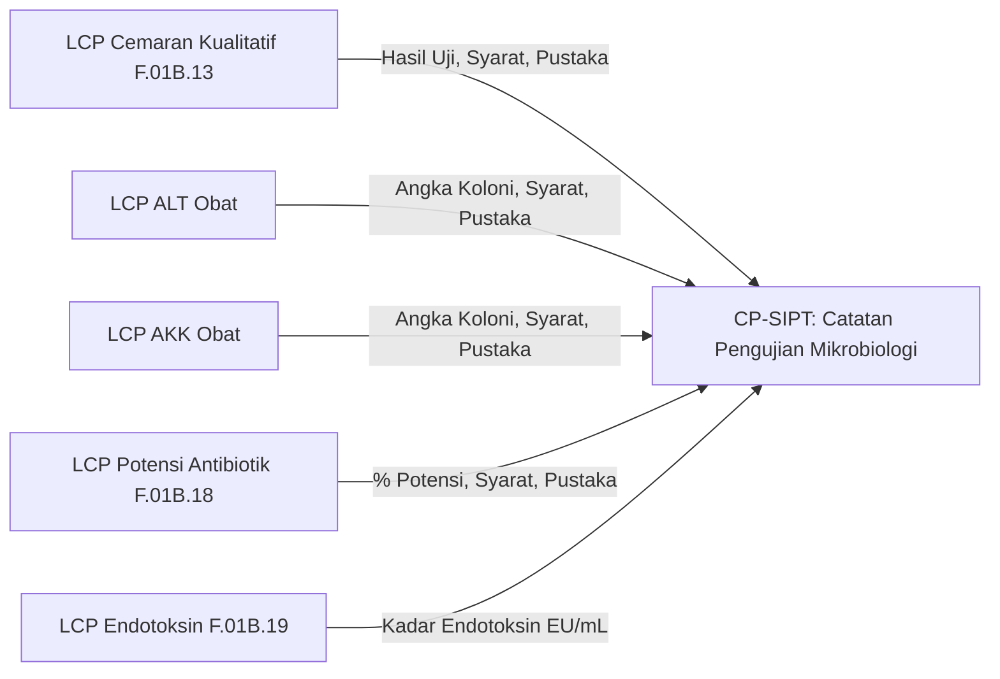

# ANALISIS WORKBOOK MIKROBIOLOGI: CEMARAN MIKROBA KUALITATIF & REKONSILIASI LCP/CP
**Status Pemeriksaan:** STRICTLY READ-ONLY (Tanpa Mengubah File Asli, Database, atau Kode)  
**Direktori Sumber Dokumen:**  
`C:\Users\ASUS\OneDrive\Dokumen\Magang BPOM\Data BPOM\Format Parameter Pengujian\Mikrobiologi`  
*(Direktori berhasil di-resolve dari padanan `%USERPROFILE%\Documents\...` pada Windows dengan sinkronisasi OneDrive)*  
**Tanggal Analisis:** 13 Oktober 2026  

---

## 1. INVENTARISASI SELURUH WORKBOOK MIKROBIOLOGI

Terdapat **7 file Excel resmi** dalam direktori target pengujian mikrobiologi:

| No | Nama Lengkap File (Filesystem) | Ekstensi | Ukuran (Bytes) | Jml Sheet | Daftar Sheet & Status Visibilitas |
|:---:|---|:---:|:---:|:---:|---|
| **1** | `CP mikro.xlsx` | `.xlsx` | 13,115 | 1 | `CP-SIPT` (Visible) |
| **2** | `POM-06.02_CFM.01_SOP.01_F.01B.13_Cemaran Mikroba Kualitatif Sediaan Farmasi_.xlsx` | `.xlsx` | 116,574 | 3 | 1. `Rapih` (Visible) 2. `contoh isi` (Visible) 3. `Kuali Sediaan Farmasi doc` (**Hidden**) |
| **3** | `LCP ALT Obat.xlsx` | `.xlsx` | 293,635 | 4 | 1. `AKK Farmasi (2)` (**Hidden**) 2. `Rapih` (Visible) 3. `ALT Farmasi` (**Hidden**) 4. `AKK Farmasi` (**Hidden**) |
| **4** | `LCP AKK Obat.xlsx` | `.xlsx` | 383,841 | 5 | 1. `Rapih` (Visible) 2. `AKK Sediaan Farmasi` (**Hidden**) 3. `ALT Farmasi (2)` (**Hidden**) 4. `AKK Farmasi (2)` (**Hidden**) 5. `AKK Farmasi` (**Hidden**) |
| **5** | `POM-06.02_CFM.01_SOP.01_F.01B.18 Potensi Antibiotik Metode Lempeng silinder 5  Dosis.xlsx` | `.xlsx` | 135,719 | 4 | 1. `Rapih (hal.1)` (Visible) 2. `Rapih (hal.2)` (Visible) 3. `POTENSI ANTIBIOTIK (hal 1)` (**Hidden**) 4. ` POTENSI ANTIBIOTIK (hal 2)` (**Hidden**) |
| **6** | `POM-06.02_CFM.01_SOP.01_F.01B.19 Endotoksin Bakteri Semi Kuantitatif .xlsx` | `.xlsx` | 180,588 | 6 | 1. `Rapih (hal-1)` (Visible) 2. `Rapih (hal 2)` (Visible) 3. `Rapih (hal 3)` (Visible) 4. `Endotoksi Bakteri (hal 1)` (**Hidden**) 5. `Endotoksin Bakteri (hal 2)` (**Hidden**) 6. `Endotoksin Bakteri (hal 3)` (**Hidden**) |
| **7** | `POM-06.02_CFM.01_SOP.01_F.01B.20 Konfirmasi Kepekaan LAL Semi Kuantitatif.xlsx` | `.xlsx` | 34,219 | 2 | 1. `Rapih` (Visible) 2. `Konfirmasi Kepekaan` (**Hidden**) |

---

## 2. ANALISIS MENDALAM: WORKBOOK CEMARAN MIKROBA KUALITATIF SEDIAAN FARMASI

File: `POM-06.02_CFM.01_SOP.01_F.01B.13_Cemaran Mikroba Kualitatif Sediaan Farmasi_.xlsx`

### A. Karakteristik & Metadata Sheet
1. **Sheet `Rapih` (Template Utama Kosong)**:
   - **Visibilitas**: Visible.
   - **Data Riil**: Berisi 280 sel berdata (dimulai dari baris 2 hingga 95, kolom A hingga S). Baris selebihnya pada XML merupakan area kosong berformat cell (row membengkak hingga 20.000 akibat format border kosong di Excel).
   - **Merged Cells**: 59 merged range (contoh: `A3:S3` untuk judul formulir, `B8:S8` untuk nama instansi, `B10:E10` untuk label sampel uji).
   - **Page Setup**: Orientasi *Portrait*, Skala *100%*, Ukuran Kertas `PaperSize = 9` (*A4*).
   - **Formula**: Tidak ada formula aritmatika otomatis (`formula_count = 0`). Seluruh perhitungan dan status diisi manual oleh analis.
   - **Checkbox / Simbol**: Menggunakan karakter Unicode `☐` (U+2610) sebagai representasi kotak pilihan centang.
2. **Sheet `contoh isi` (Sheet Referensi Pengisian)**:
   - **Visibilitas**: Visible.
   - **Karakteristik**: Memiliki struktur tabel dan sel identik dengan `Rapih`, namun terisi contoh data riil pengujian mikroba (pengujian *E. coli* dan *Pseudomonas*).
   - **Karakter Checkbox**: Nilai `☐` digantikan dengan angka integer `1` (yang merepresentasikan kondisi *checked* / terpilih).
3. **Sheet `Kuali Sediaan Farmasi doc` (Sheet Tersembunyi / Hidden)**:
   - **Visibilitas**: **HIDDEN**.
   - **Karakteristik**: Berisi draft/layout awal formulir konversi dari format Word (`.doc`) dengan 230 sel berdata dan 58 merged cells. Format ini lebih padat tetapi memiliki tata letak sedikit bergeser (misal header di baris 10-14 vs baris 8-12 pada `Rapih`).

---

### B. Pemetaan Struktur Formulir Sheet `Rapih` ke Koordinat Excel

Formulir resmi BPOM nomor `POM-06.02/CFM.01/SOP.01/F.01B.13` terbagi ke dalam 10 bagian hierarki:

#### 1. Header & Identitas Formulir:
- `A2`: `"LAMPIRAN CATATAN PENGUJIAN"` (Merged `A2:S2`, Center)
- `A3`: `"CEMARAN MIKROBA KUALITATIF SEDIAAN FARMASI"` (Merged `A3:S3`, Center, Bold)
- `B8`: `"Laboratorium Mikrobiologi Balai Besar/Balai/Loka*) POM di …........................."`

#### 2. Target Mikroba Uji (Checklist Multi-Pilihan):
- `E5`: `☐` | `F5`: `Staphylococcus aures` *(catatan: ejaan typo di dokumen asli)*
- `E6`: `☐` | `F6`: `Pseudomonas aeruginosa`
- `J5`: `☐` | `K5`: `Candida albicans`
- `J6`: `☐` | `K6`: `Shigella sp`
- `N5`: `☐` | `O5`: `Salmonella sp`
- `N6`: `☐` | `O6`: `E.coli`
- `N7`: `☐` | `O7`: `Lainnya: ..............`

#### 3. Identitas Sampel & Pengujian:
- `B10`: `Nama Sampel Uji :` (Input nilai di sel `F10`)
- `I10`: `Kode Sampel Uji :` (Input nilai di sel `L10`)
- `O10`: `Tanggal Diterima` | `Q10`: `:` | Nilai di `R10`
- `O11`: `Penguji` | `Q11`: `:` | Nilai di `R11`
- `O12`: `Tanggal Mulai Uji` | `Q12`: `:` | Nilai di `R12`

#### 4. Hasil Uji Kesesuaian Metode:
- `B14`: `Hasil Uji Kesesuaian Metode :`
- **Pelarut yang sesuai** (`B15`):
  - `E15:F15`: `☐ MLB` (Modified Neutralizing Letheen Broth)
  - `E16:F16`: `☐ TSB` (Tryptic Soy Broth)
  - `E17:F17`: `☐ TSB + 30 g/L polysorbate 80`
  - `E18:F18`: `☐ TSB + 30 g/L polysorbate 80 + 3 g/L Lesitin`
  - `E19:F19`: `☐ Lainnya: …..................`
- **Mikroba Baku** (`L15`):
  - `L16:M16`: `☐ Staphylococcus aures ATCC / WDCM …................`
  - `L17:M17`: `☐ Pseudomonas aeruginosa ATCC / WDCM …...............`
  - `L18:M18`: `☐ Candida albicans ATCC / WDCM …...............`
  - `L19:M19`: `☐ Lainnya: …..........................`

#### 5. Homogenisasi Awal:
- `B21`: `Homogenisasi Awal`
- `B22`: `Penimbangan/Pemipetan Sampel` | `E22`: `:` | `F22`: `10.0` | `G22`: `g atau mL *)`
- `B23`: `Pelarut` | `E23`: `:` | `F23`: `90.0` | `G23`: `mL`
- Pilihan Pelarut Homogenisasi:
  - `H23:I23`: `☐ MLB`
  - `H24:I24`: `☐ TSB`
  - `H25:I25`: `☐ TSB + 30 g/L polysorbate 80`
  - `H26:I26`: `☐ TSB + 30 g/L polysorbate 80 + 3 g/L Lesitin`
  - `H27:I27`: `☐ Lainnya : ….................`

#### 6. Tabel Matriks Tahapan Uji (Baris 29–65):
Struktur kolom matriks:
- **Kolom B**: `Tanggal`
- **Kolom C–D**: `Tahapan Uji`
- **Kolom E–G**: `Media`
- **Kolom H–K**: `Inkubasi` (Suhu `H:I`, Waktu `J:K`)
- **Kolom L–M**: `Kesesuaian Metode (Sampel + Spike)`
- **Kolom N–O**: `Kontrol Positif (Media Tanpa sampel + Spike)`
- **Kolom P–Q**: `Kontrol Media (Tanpa Sampel dan Tanpa Spike)`
- **Kolom R–S**: `Sampel Uji`

Daftar Baris Tahapan:
1. **Pra Pengayaan** (`C34`):
   - Media: `E34` (`sesuai pelarut yang digunakan saat homogenisasi awal`)
   - Suhu: `I34` (`30-37`) °C | Waktu: `K34` (`2 - 5`) Jam
   - Inokulum: `1 g atau mL` (`L31, N31, P31, R31`) / `0,1 g atau mL` (`L32, N32, P32, R32`)
2. **Pengayaan / Pengayaan Selektif** (`D38–D44`):
   - Pilihan Media: `MLB 10 mL` (`E38:G38`), `TSB 90 mL` (`E39:G39`), `TSB 100 mL` (`E40:G40`), `EEB 90 mL` (`E41:G41`), `Lactose Broth 100 mL` (`E42:G42`), `Lainnya` (`E43`).
   - Suhu: `30-35 °C` (`I38`), `35-37 °C` (`I39`). Waktu: `18-24 Jam` (`K38`), `24-48 Jam` (`K39`).
   - Pengamatan: `Keruh` di Kontrol Positif (`N37`).
3. **Seleksi** (`D46–D49`):
   - Media: `RVS 10 mL` (`G46`), `TBGB 100 mL` (`G47`), `Lainnya` (`G48`).
   - Suhu: `30-35 °C` (`I46`). Waktu: `24-48 Jam` (`K46`).
4. **Sub Kultur / Isolasi** (`D51–D59`):
   - Media Agar: `BPA` (`G51`), `MSA` (`G52`), `CETA` (`G53`), `SDA` (`G54`), `XLD` (`G55`), `BGA` (`G56`), `MCA` (`G57`), `Lainnya` (`G58`).
   - Suhu: `30-35 °C` (`I51`). Waktu: `18-72 Jam` (`K51`), `18-24 Jam` (`K52`).
5. **Konfirmasi** (`C60–C65`):
   - Pilihan: `☐ Biokimia Kit` (`E60:F60`) atau `☐ Biokimia Konvensional` (`E64:F64`).
   - Suhu: `35-37 °C` (`I61`). Waktu: `18-24 Jam` (`K61`).

#### 7. Kriteria Pembacaan Hasil Koloni Spesifik (Pedoman Interpretasi, Baris 75–82):
- **S. aureus**: `BPA` (Hitam mengkilat zona bening), `VJA` (Hitam mengkilat), `MSA` (Kuning).
- **P. aeruginosa**: `CETA` (Kuning kehijauan dengan fluoresensi di bawah sinar UV).
- **C. albicans**: `SDA` (Putih s/d krem, cembung licin).
- **Salmonella spp**: `BGA` (Merah muda/translusen dgn lingkaran merah), `XLD` (Merah bintik hitam).
- **Shigella spp**: `XLD` (Putih-merah muda, media merah), `MCA` (Putih oranye bergerigi).
- **E. coli**: `MCA` (Merah muda/merah dikelilingi presipitasi merah gelap).

#### 8. Pustaka, Syarat, Hasil, Kesimpulan, dan Tanda Tangan:
- `B84:C84`: `Hasil Uji` | `D84`: `: [Isian hasil kualitatif]`
- `B86:C86`: `Pustaka/Metode` | `D86`: `: [Isian pustaka/monografi]`
- `N86`: `Syarat : [Isian spesifikasi monografi]`
- `B89:C89`: `KESIMPULAN :` | `D89`: `Memenuhi Syarat (MS) / Tidak Memenuhi Syarat (TMS) / Hasil Pengujian Seperti Tersebut (HPST) *)`
- `B91`: `Tanda Tangan Penguji :` | `B93`: `Tanggal :`
- `N91`: `Diperiksa oleh :` | `P92`: `(TTD, Nama)` | `N93`: `Tanggal :`
- `B95`: Nomor Formulir Resmi: `"POM-06.02/CFM.01/SOP.01/F.01B.13"` | `Q95`: `"Lembar ... dari ... halaman"`

---

## 3. PERBANDINGAN SHEET `Rapih` VS `contoh isi`

Perbandingan sel-demi-sel antara template kosong (`Rapih`) dan sheet referensi (`contoh isi`):

| Koordinat | Sheet `Rapih` (Template) | Sheet `contoh isi` (Contoh Pengisian) | Analisis Makna Pengisian |
|:---:|---|---|---|
| `F22` | *[Kosong]* | `10.0` | Penimbangan bobot sampel uji (10 gram). |
| `F23` | *[Kosong]* | `90.0` | Volume pelarut pengenceran 1:10 (90 mL). |
| `E19` / `H27` | `☐` (Kotak kosong) | `1` | Checkbox pelarut terpilih: nilai `1` menandakan pilihan *checked*. |
| `F19` / `I27` | `Lainnya: …..................` | `Lainnya: LDF` | Analis mengetik pelarut custom: *LDF* (Letheen Diluent Fluid). |
| `B34` | *[Kosong]* | `N/A` | Kolom tanggal pra-pengayaan ditulis *N/A* jika tidak dilakukan. |
| `L34, N34, P34, R34`| *[Kosong]* | `N/A` | Matriks pembacaan pra-pengayaan diberi tanda *N/A*. |
| `C39, C41, C47, C52`| `☐` | `1` | Pemilihan tahapan pengayaan dan seleksi spesifik mikroba. |
| `F48` | `Lainnya:…..............` | `Lainnya: MCB` | Media seleksi kustom: *MCB* (MacConkey Broth). |
| `E57` | `☐` | `1` | Pemilihan media agar: *MCA* (MacConkey Agar) untuk *E. coli*. |

> [!NOTE]
> Pada sistem digital LIMSKU, mekanisme boolean ini harus dipetakan menjadi input checkbox interaktif (`true`/`false`), sedangkan kolom *Lainnya* menjadi input teks bersyarat (*conditional text input*).

---

## 4. PERBANDINGAN DOKUMEN LCP VS CP MIKROBIOLOGI

Berdasarkan analisis terhadap `CP mikro.xlsx` dan keenam workbook LCP:

### A. Tabel Konsolidasi Hubungan LCP $\rightarrow$ CP Mikro:
1. **Peran LCP (Lembar Catatan Pengujian)**:
   - Berfungsi sebagai **lembar kerja teknis analis di meja laboratorium**.
   - Mencatat seluruh rincian proses basah: media yang dipakai, suhu inkubator, durasi jam inkubasi, pengamatan visual kekeruhan kontrol positif, kontrol negatif, morfologi koloni pada agar, hingga reaksi biokimia.
2. **Peran CP (Catatan Pengujian - `CP-SIPT`)**:
   - Berfungsi sebagai **ringkasan eksekutif pengujian sampel** untuk verifikasi Penyelia dan Manajer Teknis.
   - Mengambil data dari LCP pada Bagian 9 (`Hasil Pengujian` baris 19–26):
     * Kolom `Uji yang dilakukan`: Diambil dari parameter monografi (misal: *Cemaran Mikroba Kualitatif (E. coli)*).
     * Kolom `Hasil`: Diambil dari sel `D84` LCP (misal: *Negatif per 10 gram*).
     * Kolom `Syarat`: Diambil dari sel `N86` LCP (misal: *Harus negatif*).
     * Kolom `Pustaka`: Diambil dari sel `D86` LCP (misal: *Farmakope Indonesia Edisi VI*).
     * Kolom `Metode`: Diambil dari kode formulir LCP (`POM-06.02/CFM.01/SOP.01/F.01B.13`).
3. **Data Pemerian Fisik**:
   - CP Mikrobiologi memiliki bagian pemeriksaan fisik sampel mandiri pada Baris 18:
     * `Bentuk` (`B18:C18`), `Warna` (`D18:E18`), `Bau` (`G18`), `Rasa` (`H18`).
   - Bagian ini diisi langsung di lembar CP sebelum/setelah uji mikrobiologi dilakukan.

---

## 5. TEMUAN KELAINAN EJAAN & HAL YANG MEMERLUKAN KONFIRMASI LABORATORIUM

1. **Typo / Kelainan Ejaan pada Dokumen Resmi**:
   - Pada sel `F5` tertulis `Staphylococcus aures` (seharusnya *Staphylococcus aureus*).
   - Pada baris 82 tertulis `Shigella sp` sementara di baris 75 tertulis `Shigella spp`.
   - *Rekomendasi*: Pada database dan label form digital, tampilkan teks sesuai dokumen resmi namun sediakan opsi penyesuaian nomenklatur mikrobiologi baku setelah konfirmasi analis.
2. **Kesesuaian Kode Dokumen Antar-Sheet**:
   - Pada sheet `Rapih` baris 95 tertulis `POM-06.02/CFM.01/SOP.01/F.01B.13`.
   - Pada sheet `Kuali Sediaan Farmasi doc` (hidden) baris 94 tertulis `POM-06.02/CFM.01/SOP.01/F.01B.13`.
   - Format kode dokumen konsisten.
3. **Opsi Kesimpulan (Tiga Pilihan)**:
   - Formulir menyediakan 3 opsi kesimpulan di baris 89:
     1. `Memenuhi Syarat (MS)`
     2. `Tidak Memenuhi Syarat (TMS)`
     3. `Hasil Pengujian Seperti Tersebut (HPST)`
   - *Konfirmasi*: Kapan status `HPST` digunakan pada uji kualitatif (biasanya untuk pengujian pihak ketiga/eksternal atau uji coba tanpa spesifikasi resmi).

---

## 6. BATASAN TEKNIS PEMERIKSAAN & KESIMPULAN

- **Batasan**: Analisis ini dijalankan secara read-only murni berbasis parsing OpenXML (struktur XML zip). Tidak ada macro VBA yang dijalankan.
- **Integritas Database & Repository**: Database `limsku`, data 723 monografi, dan master repositori Git tetap terlindungi 100% tanpa perubahan apa pun.
- Dokumen laporan ini disimpan secara aman pada:  
  `C:\xampp\htdocs\LIMSKU\docs\ANALISIS_WORKBOOK_MIKROBIOLOGI.md`
