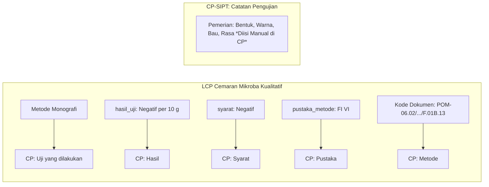

# SPESIFIKASI IMPLEMENTASI LCP CEMARAN MIKROBA KUALITATIF SEDIAAN FARMASI
**Kode Dokumen Resmi:** `POM-06.02/CFM.01/SOP.01/F.01B.13`  
**Sumber Excel:** `POM-06.02_CFM.01_SOP.01_F.01B.13_Cemaran Mikroba Kualitatif Sediaan Farmasi_.xlsx` (Sheet: `Rapih`)  
**Target Modul:** Modul Pengujian & Master Template LIMSKU (`C:\xampp\htdocs\LIMSKU`)  
**Status Tahap:** DESAIN & SPESIFIKASI TEKNIS (Strictly Read-Only — Tanpa Perubahan Database/Kode)  
**Tanggal Penyusunan:** 13 Oktober 2026  

---

## 1. PENDAHULUAN & PRINSIP DESAIN

Dokumen spesifikasi ini mendefinisikan seluruh variabel teknis, struktur data, dan aturan antarmuka untuk digitalisasi formulir **Lembar Catatan Pengujian (LCP) Cemaran Mikroba Kualitatif Sediaan Farmasi** ke dalam sistem LIMSKU.

### Prinsip Utama:
1. **Penelusuran Koordinat (Traceability)**: Setiap elemen formulir dipetakan secara eksak ke koordinat baris dan kolom pada sheet resmi `Rapih`.
2. **Integritas Istilah Asli**: Mempertahankan istilah, singkatan reagen/media, dan nomenklatur sebagaimana tercantum pada dokumen BPOM asli.
3. **Pemisahan Definisi Form dan Data Hasil**: `form_templates.skema_form` mendefinisikan metadata struktur form secara independen, sementara `test_results.data_hasil` hanya menyimpan payload nilai aktual analis.
4. **Keamanan Eksekusi (Zero-Eval)**: Tidak menggunakan fungsi berbahaya seperti `eval()` dalam pemrosesan data, validasi, maupun formula.
5. **Dukungan Agregasi CP-SIPT**: Field ringkasan (*Hasil*, *Syarat*, *Pustaka*, *Metode*) dipisahkan secara terstruktur agar dapat diserap langsung oleh dokumen Catatan Pengujian (`CP-SIPT`) tanpa perlu pengisian ulang.

---

## 2. SPESIFIKASI FIELD FORMULIR SECARA LENGKAP

Berikut adalah rincian seluruh elemen formulir yang dikelompokkan ke dalam 8 bagian logis:

### Bagian 1: Identitas Dokumen & Target Mikroba Uji
Bagian ini menentukan parameter cemaran mikroba spesifik yang diuji pada sampel sediaan farmasi.

| ID Field | Label Asli Dokumen | Tipe Input | Tipe Data | Sumber Data | Koordinat Excel | Aturan & Keterangan |
|---|---|---|---|---|:---:|---|
| `target_staphylococcus` | `Staphylococcus aures` | `checkbox` | `boolean` | Analis | `E5:F5` | *Catatan: Ejaan asli pada template tertulis 'aures'* |
| `target_pseudomonas` | `Pseudomonas aeruginosa` | `checkbox` | `boolean` | Analis | `E6:F6` | Pilihan target mikroba |
| `target_candida` | `Candida albicans` | `checkbox` | `boolean` | Analis | `J5:K5` | Pilihan target mikroba |
| `target_shigella` | `Shigella sp` | `checkbox` | `boolean` | Analis | `J6:K6` | Pilihan target mikroba |
| `target_salmonella` | `Salmonella sp` | `checkbox` | `boolean` | Analis | `N5:O5` | Pilihan target mikroba |
| `target_ecoli` | `E.coli` | `checkbox` | `boolean` | Analis | `N6:O6` | Pilihan target mikroba |
| `target_lainnya_check` | `Lainnya:` | `checkbox` | `boolean` | Analis | `N7` | Centang jika ada mikroba target tambahan |
| `target_lainnya_text` | `Lainnya: ..............` | `text` | `string` | Analis | `O7` | Wajib jika `target_lainnya_check = true` |
| `lab_lokasi` | `Laboratorium Mikrobiologi Balai Besar/Balai/Loka*) POM di …` | `static_text` | `string` | Sistem | `B8:S8` | Default konfigurasi: *Balai Besar POM di Bandar Lampung* |

---

### Bagian 2: Identitas Sampel & Penguji (Header Sampel)
Field identitas ini secara otomatis dihubungkan (*auto-bind*) dari tabel `samples` dan `testing_sessions` tanpa perlu diketik ulang oleh analis.

| ID Field | Label Asli Dokumen | Tipe Input | Sumber Data | Binding Database LIMSKU | Koordinat Excel |
|---|---|---|---|---|:---:|
| `nama_sampel_uji` | `Nama Sampel Uji :` | `display` | Sistem | `samples.nama_sampel` | `B10:H10` |
| `kode_sampel_uji` | `Kode Sampel Uji :` | `display` | Sistem | `samples.kode_sampel_manual` / `samples.no` | `I10:N10` |
| `tanggal_diterima` | `Tanggal Diterima :` | `display` | Sistem | `samples.tanggal_sampling` / `samples.created_at` | `O10:R10` |
| `nama_penguji` | `Penguji :` | `display` | Sistem | `users.nama_lengkap` (via `testing_sessions.penguji_id`) | `O11:R11` |
| `tanggal_mulai_uji` | `Tanggal Mulai Uji :` | `date` | Analis/Sistem | `testing_sessions.waktu_mulai` | `O12:R12` |

---

### Bagian 3: Hasil Uji Kesesuaian Metode
Pemeriksaan kontrol kelayakan metode pengujian terhadap sampel dan galur baku pembanding.

| ID Field | Label Asli Dokumen | Tipe Input | Tipe Data | Sumber Data | Koordinat Excel | Pilihan / Opsi |
|---|---|---|---|---|:---:|---|
| `pelarut_kesesuaian` | `Pelarut yang sesuai :` | `radio` | `string` | Analis | `B15:F19` | Pilihan tunggal:<br>- `MLB`<br>- `TSB`<br>- `TSB + 30 g/L polysorbate 80`<br>- `TSB + 30 g/L polysorbate 80 + 3 g/L Lesitin`<br>- `Lainnya` |
| `pelarut_kesesuaian_lainnya` | `Lainnya: …..................` | `text` | `string` | Analis | `F19` | Tampil jika `pelarut_kesesuaian = 'Lainnya'` |
| `baku_staphylococcus` | `Staphylococcus aures ATCC / WDCM …` | `checkbox` | `boolean` | Analis | `L16:M16` | Multi-pilihan mikroba baku pembanding |
| `baku_staphylococcus_no` | `No ATCC/WDCM S. aureus` | `text` | `string` | Analis | `M16` | Nomor galur ATCC/WDCM |
| `baku_pseudomonas` | `Pseudomonas aeruginosa ATCC / WDCM …` | `checkbox` | `boolean` | Analis | `L17:M17` | Multi-pilihan mikroba baku pembanding |
| `baku_pseudomonas_no` | `No ATCC/WDCM P. aeruginosa` | `text` | `string` | Analis | `M17` | Nomor galur ATCC/WDCM |
| `baku_candida` | `Candida albicans ATCC / WDCM …` | `checkbox` | `boolean` | Analis | `L18:M18` | Multi-pilihan mikroba baku pembanding |
| `baku_candida_no` | `No ATCC/WDCM C. albicans` | `text` | `string` | Analis | `M18` | Nomor galur ATCC/WDCM |
| `baku_lainnya` | `Lainnya: …..........................` | `text` | `string` | Analis | `L19:M19` | Galur baku lainnya |

---

### Bagian 4: Homogenisasi Awal
Preparasi awal penimbangan sampel dan penambahan volume pelarut suspensi.

| ID Field | Label Asli Dokumen | Tipe Input | Default | Unit | Sumber Data | Koordinat Excel |
|---|---|---|:---:|:---:|---|:---:|
| `bobot_sampel_homogenisasi` | `Penimbangan/Pemipetan Sampel` | `number` | `10.0` | `g atau mL` | Analis | `B22:G22` |
| `volume_pelarut_homogenisasi`| `Pelarut` | `number` | `90.0` | `mL` | Analis | `B23:G23` |
| `jenis_pelarut_homogenisasi` | `Pilihan Pelarut Homogenisasi` | `radio` | - | - | Analis | `H23:I27` |
| *(opsi pelarut)* | - | - | - | - | - | - `MLB`<br>- `TSB`<br>- `TSB + 30 g/L polysorbate 80`<br>- `TSB + 30 g/L polysorbate 80 + 3 g/L Lesitin`<br>- `Lainnya` |
| `pelarut_homogenisasi_lainnya`| `Lainnya : ….................` | `text` | - | - | Analis | `I27` |

---

### Bagian 5: Matriks Tahapan Pengujian (Tabel Alur Uji)
Matriks bertahap dari pra-pengayaan hingga konfirmasi. Setiap tahapan memiliki atribut tanggal pengerjaan, pilihan media, kondisi inkubasi (suhu & waktu), serta pengamatan pada 4 kondisi kontrol:
1. *Kesesuaian Metode (Sampel + Spike)*
2. *Kontrol Positif (Media Tanpa sampel + Spike)*
3. *Kontrol Media (Tanpa Sampel dan Tanpa Spike)*
4. *Sampel Uji*

#### A. Inokulum Uji (Header Matriks, Baris 31–33):
- `inokulum_tingkat`: Radio / Pilihan volume inokulum: `1 g atau mL` (`L31`), `0,1 g atau mL` (`L32`), `Lainnya` (`L33`).

#### B. Rincian Baris Tahapan Uji:

| Kode Tahap | Nama Tahapan | Baris Excel | Opsi Media | Suhu Baku (°C) | Waktu Baku (Jam) | Pengamatan Baku di Template |
|---|---|:---:|---|:---:|:---:|---|
| `tahap_pra_pengayaan` | **Pra Pengayaan** | `34–37` | Sesuai pelarut homogenisasi awal | `30-37` | `2 - 5` | Kontrol Positif: *Keruh* (`N37`) |
| `tahap_pengayaan` | **Pengayaan / Pengayaan Selektif** | `38–44` | - `MLB 10 mL`<br>- `TSB 90 mL`<br>- `TSB 100 mL`<br>- `EEB 90 mL`<br>- `Lactose Broth 100 mL`<br>- `Lainnya` | `30 - 35` atau `35 - 37` | `18 - 24` atau `24 - 48` | Kontrol Positif: *Keruh* (`N45`) |
| `tahap_seleksi` | **Seleksi** | `46–49` | - `RVS 10 mL`<br>- `TBGB 100 mL`<br>- `Lainnya` | `30 - 35` | `24 - 48` | Kontrol Positif: *Positif* (`N50`) |
| `tahap_isolasi` | **Sub Kultur / Isolasi** | `51–59` | - `BPA`<br>- `MSA`<br>- `CETA`<br>- `SDA`<br>- `XLD`<br>- `BGA`<br>- `MCA`<br>- `Lainnya` | `30 - 35` | `18 - 24` atau `18 - 72` | Pengamatan morfologi koloni pada lempeng agar |
| `tahap_konfirmasi` | **Konfirmasi** | `60–65` | - `Biokimia Kit`<br>- `Biokimia Konvensional` | `35 - 37` | `18 - 24` | Uji reaksi biokimia / kit identifikasi |

*Field yang dicatat analis per baris tahapan aktif:*
- `tanggal_tahap`: Tanggal pengujian (`date`)
- `media_terpilih`: Pilihan media spesifik (`string`)
- `suhu_inkubasi`: Suhu aktual inkubator (`string` / `number`)
- `waktu_inkubasi`: Durasi inkubasi dalam jam (`string` / `number`)
- `obs_kesesuaian_metode`: Pengamatan visual sampel + spike (`string`, misal: *Keruh* / *Ada Koloni*)
- `obs_kontrol_positif`: Pengamatan visual media + spike (`string`, misal: *Keruh*)
- `obs_kontrol_media`: Pengamatan visual kontrol negatif media (`string`, misal: *Jernih* / *Steril*)
- `obs_sampel_uji`: Pengamatan visual sampel uji (`string`, misal: *Jernih* / *Keruh* / *Koloni Spesifik*)

---

### Bagian 6: Pedoman Kriteria Koloni Spesifik (Referensi Visual)
Field ini bersifat referensi visual (*read-only reference guide*) yang tampil pada UI analis untuk memverifikasi kecocokan koloni pada media agar isolasi (Baris 75–82):
- **Staphylococcus aureus**:
  - `BPA`: Koloni cembung, warna hitam mengkilat dikelilingi zona bening.
  - `VJA`: Koloni cembung, warna hitam mengkilat.
  - `MSA`: Koloni cembung, warna kuning.
- **Pseudomonas aeruginosa**:
  - `CETA`: Koloni berwarna kuning kehijauan dengan fluoresensi di bawah lampu UV.
- **Candida albicans**:
  - `SDA`: Koloni berwarna putih sampai krem, permukaan cembung dan licin.
- **Salmonella spp**:
  - `BGA`: Koloni kecil, tidak berwarna / merah muda translusen dgn lingkaran merah.
  - `XLD`: Koloni berwarna merah dengan atau tanpa bintik hitam di tengah.
- **Shigella spp**:
  - `XLD`: Koloni bulat putih-merah muda, media berubah menjadi merah.
  - `MCA`: Koloni bergerigi warna putih oranye, media berubah menjadi oranye.
- **Escherichia coli**:
  - `MCA`: Koloni merah muda hingga merah dikelilingi zona presipitasi merah gelap.

---

### Bagian 7: Hasil Uji, Spesifikasi, dan Kesimpulan
Bagian eksekutif yang menjadi ringkasan hasil pengujian dan penentuan kelayakan sampel.

| ID Field | Label Asli Dokumen | Tipe Input | Tipe Data | Wajib (Required) | Koordinat Excel | Keterangan |
|---|---|---|---|:---:|:---:|---|
| `hasil_uji` | `Hasil Uji` | `textarea` / `text` | `string` | **Ya** | `B84:D84` | Contoh: *"Negatif / 10 g"* atau *"Tidak ditemukan Salmonella sp"* |
| `pustaka_metode` | `Pustaka/Metode` | `text` | `string` | **Ya** | `B86:D86` | Contoh: *"Farmakope Indonesia Edisi VI (2020)"* |
| `syarat` | `Syarat :` | `text` | `string` | **Ya** | `N86` | Contoh: *"Negatif"* atau *"Harus bebas dari E. coli"* |
| `kesimpulan` | `KESIMPULAN :` | `select` | `enum` | **Ya** | `B89:D89` | Pilihan resmi:<br>1. `Memenuhi Syarat (MS)`<br>2. `Tidak Memenuhi Syarat (TMS)`<br>3. `Hasil Pengujian Seperti Tersebut (HPST)` |

---

### Bagian 8: Pengesahan & Tanda Tangan
Bagian verifikasi berjenjang sesuai alur mutu laboratorium pengujian.

| ID Field | Label Asli Dokumen | Tipe Input | Sumber Data | Koordinat Excel | Keterangan |
|---|---|---|---|:---:|---|
| `penguji_nama` | `Tanda Tangan Penguji :` | `display` | `users.nama_lengkap` | `B91` | Penguji yang ditugaskan |
| `penguji_tanggal`| `Tanggal :` | `date` | `testing_sessions.waktu_selesai` | `B93` | Tanggal penyelesaian analisis |
| `penyelia_nama` | `Diperiksa oleh :` | `display` | `users.nama_lengkap` | `N91` | Penyelia yang memverifikasi |
| `penyelia_tanggal`| `Tanggal :` | `date` | `testing_sessions.waktu_verifikasi`| `N93` | Tanggal verifikasi |
| `nomor_formulir`| `POM-06.02/CFM.01/SOP.01/F.01B.13`| `static` | Konstanta | `B95` | Kode resmi formulir |

---

## 3. RANCANGAN STRUKTUR JSON

### A. Skema Form Template (`form_templates.skema_form`)
Format JSON yang mendefinisikan struktur formulir dinamis secara deklaratif:

```json
{
  "kode_dokumen": "POM-06.02/CFM.01/SOP.01/F.01B.13",
  "judul": "Cemaran Mikroba Kualitatif Sediaan Farmasi",
  "sections": [
    {
      "id": "target_mikroba",
      "title": "Target Cemaran Mikroba yang Diuji",
      "fields": [
        {"id": "target_staphylococcus", "label": "Staphylococcus aures", "type": "checkbox"},
        {"id": "target_pseudomonas", "label": "Pseudomonas aeruginosa", "type": "checkbox"},
        {"id": "target_candida", "label": "Candida albicans", "type": "checkbox"},
        {"id": "target_shigella", "label": "Shigella sp", "type": "checkbox"},
        {"id": "target_salmonella", "label": "Salmonella sp", "type": "checkbox"},
        {"id": "target_ecoli", "label": "E.coli", "type": "checkbox"},
        {"id": "target_lainnya_check", "label": "Lainnya", "type": "checkbox"},
        {"id": "target_lainnya_text", "label": "Mikroba Lainnya", "type": "text", "depends_on": "target_lainnya_check"}
      ]
    },
    {
      "id": "kesesuaian_metode",
      "title": "Hasil Uji Kesesuaian Metode",
      "fields": [
        {
          "id": "pelarut_kesesuaian",
          "label": "Pelarut yang Sesuai",
          "type": "radio",
          "options": [
            "MLB",
            "TSB",
            "TSB + 30 g/L polysorbate 80",
            "TSB + 30 g/L polysorbate 80 + 3 g/L Lesitin",
            "Lainnya"
          ]
        },
        {"id": "pelarut_kesesuaian_lainnya", "label": "Pelarut Lainnya", "type": "text", "depends_on": "pelarut_kesesuaian=Lainnya"},
        {"id": "baku_staphylococcus", "label": "Staphylococcus aures ATCC/WDCM", "type": "checkbox"},
        {"id": "baku_staphylococcus_no", "label": "No. Galur S. aureus", "type": "text"},
        {"id": "baku_pseudomonas", "label": "Pseudomonas aeruginosa ATCC/WDCM", "type": "checkbox"},
        {"id": "baku_pseudomonas_no", "label": "No. Galur P. aeruginosa", "type": "text"},
        {"id": "baku_candida", "label": "Candida albicans ATCC/WDCM", "type": "checkbox"},
        {"id": "baku_candida_no", "label": "No. Galur C. albicans", "type": "text"},
        {"id": "baku_lainnya", "label": "Mikroba Baku Lainnya", "type": "text"}
      ]
    },
    {
      "id": "homogenisasi_awal",
      "title": "Homogenisasi Awal",
      "fields": [
        {"id": "bobot_sampel", "label": "Penimbangan/Pemipetan Sampel", "type": "number", "default": 10.0, "unit": "g atau mL", "required": true},
        {"id": "volume_pelarut", "label": "Pelarut", "type": "number", "default": 90.0, "unit": "mL", "required": true},
        {
          "id": "jenis_pelarut_homogenisasi",
          "label": "Pilihan Pelarut Homogenisasi",
          "type": "radio",
          "options": [
            "MLB",
            "TSB",
            "TSB + 30 g/L polysorbate 80",
            "TSB + 30 g/L polysorbate 80 + 3 g/L Lesitin",
            "Lainnya"
          ]
        },
        {"id": "pelarut_homogenisasi_lainnya", "label": "Pelarut Homogenisasi Lainnya", "type": "text"}
      ]
    },
    {
      "id": "tahapan_pengujian",
      "title": "Matriks Tahapan Pengujian",
      "fields": [
        {
          "id": "inokulum_tingkat",
          "label": "Tingkat Inokulum",
          "type": "radio",
          "options": ["1 g atau mL", "0,1 g atau mL", "Lainnya"]
        },
        {
          "id": "tabel_tahapan",
          "label": "Tabel Pengamatan Tahap Uji",
          "type": "table",
          "columns": [
            {"id": "tahap", "label": "Tahapan Uji", "type": "text", "readonly": true},
            {"id": "tanggal", "label": "Tanggal", "type": "date"},
            {"id": "media", "label": "Media", "type": "text"},
            {"id": "suhu", "label": "Suhu (°C)", "type": "text"},
            {"id": "waktu", "label": "Waktu (Jam)", "type": "text"},
            {"id": "sampel_spike", "label": "Sampel + Spike", "type": "text"},
            {"id": "media_spike", "label": "Media + Spike", "type": "text"},
            {"id": "kontrol_media", "label": "Kontrol Media", "type": "text"},
            {"id": "sampel_uji", "label": "Sampel Uji", "type": "text"}
          ]
        }
      ]
    },
    {
      "id": "hasil_dan_kesimpulan",
      "title": "Hasil, Spesifikasi, & Kesimpulan",
      "fields": [
        {"id": "hasil_uji", "label": "Hasil Uji", "type": "textarea", "required": true},
        {"id": "pustaka_metode", "label": "Pustaka/Metode", "type": "text", "required": true},
        {"id": "syarat", "label": "Syarat", "type": "text", "required": true},
        {
          "id": "kesimpulan_lcp",
          "label": "Kesimpulan",
          "type": "select",
          "options": [
            "Memenuhi Syarat (MS)",
            "Tidak Memenuhi Syarat (TMS)",
            "Hasil Pengujian Seperti Tersebut (HPST)"
          ],
          "required": true
        }
      ]
    }
  ]
}
```

---

### B. Contoh Payload Data Hasil (`test_results.data_hasil`)
Contoh representasi data riil yang disimpan saat analis mengisi formulir pengujian *E. coli*:

```json
{
  "parameter_values": {
    "target_ecoli": true,
    "target_staphylococcus": false,
    "target_pseudomonas": false,
    "pelarut_kesesuaian": "Lainnya",
    "pelarut_kesesuaian_lainnya": "LDF",
    "bobot_sampel": 10.0,
    "volume_pelarut": 90.0,
    "jenis_pelarut_homogenisasi": "Lainnya",
    "pelarut_homogenisasi_lainnya": "LDF",
    "inokulum_tingkat": "1 g atau mL",
    "tabel_tahapan": [
      {
        "tahap": "Pra Pengayaan",
        "tanggal": "2026-10-14",
        "media": "LDF",
        "suhu": "30-37",
        "waktu": "2-5",
        "sampel_spike": "Keruh",
        "media_spike": "Keruh",
        "kontrol_media": "Jernih",
        "sampel_uji": "Jernih"
      },
      {
        "tahap": "Pengayaan Selektif",
        "tanggal": "2026-10-14",
        "media": "EEB 90 mL",
        "suhu": "35-37",
        "waktu": "24-48",
        "sampel_spike": "Keruh",
        "media_spike": "Keruh",
        "kontrol_media": "Jernih",
        "sampel_uji": "Jernih"
      },
      {
        "tahap": "Sub Kultur / Isolasi",
        "tanggal": "2026-10-15",
        "media": "MCA",
        "suhu": "30-35",
        "waktu": "18-24",
        "sampel_spike": "Koloni merah muda",
        "media_spike": "Koloni merah muda",
        "kontrol_media": "Tidak ada koloni",
        "sampel_uji": "Tidak ada koloni"
      }
    ],
    "hasil_uji": "Negatif per 10 g",
    "pustaka_metode": "Farmakope Indonesia Edisi VI (2020)",
    "syarat": "Negatif",
    "kesimpulan_lcp": "Memenuhi Syarat (MS)"
  },
  "alat_ids": [102, 145],
  "reagen_ids": [1]
}
```

---

## 4. PEMETAAN RINGKASAN DATA LCP KE DOKUMEN CP-SIPT

Berdasarkan struktur workbook `CP mikro.xlsx`, lembar **Catatan Pengujian Mikrobiologi** mengambil ringkasan dari LCP Cemaran Mikroba Kualitatif secara otomatis pada baris 19–26:



### Aturan Integrasi:
1. **Otomatis Diteruskan**:
   - `Uji yang dilakukan`: Nama parameter dari `methods.parameter_uji` (misal: *Cemaran Mikroba Kualitatif*).
   - `Hasil`: Nilai dari `data_hasil.parameter_values.hasil_uji`.
   - `Syarat`: Nilai dari `data_hasil.parameter_values.syarat` (atau spesifikasi monografi).
   - `Pustaka`: Nilai dari `data_hasil.parameter_values.pustaka_metode`.
   - `Metode`: Kode resmi LCP (`POM-06.02/CFM.01/SOP.01/F.01B.13`).
2. **Tidak Boleh Diasumsikan Terisi Otomatis**:
   - Bagian **Pemerian Fisik** pada CP (`Bentuk`, `Warna`, `Bau`, `Rasa` pada baris 18 `CP mikro.xlsx`) adalah pemeriksaan organoleptik mikrobiologi yang diisi langsung pada level CP sampel, bukan turunan dari LCP mikroba.
   - Sisa Sampel (`F29`) dan Label Sampel (`F14`) diisi pada proses verifikasi sampel akhir.

---

## 5. TINJAUAN KEBUTUHAN DATABASE & ARSITEKTUR KODE

### A. Tabel Database Terkait:
- **`form_templates`**:
  * Record baru akan disisipkan dengan `kode_template = 'MIK-04'`, `nama_template = 'Uji Cemaran Mikroba Kualitatif Sediaan Farmasi'`, `kategori = 'Mikrobiologi'`, `status = 'Aktif'`.
  * *Penting*: Tidak menggunakan hard-coded ID numeric. Pemetaan mengacu pada `kode_template` unik.
- **`test_results`**:
  * Kolom `data_hasil` (tipe `longtext`) menyimpan payload JSON terstruktur di atas secara native tanpa memerlukan alter tabel fisik.
- **`testing_sessions` & `samples`**:
  * Alur status (`Sedang Diuji` $\rightarrow$ `Menunggu Verifikasi` $\rightarrow$ `Menunggu Approval` $\rightarrow$ `Approved / Final`) tetap berjalan konsisten tanpa modifikasi alur.

### B. Kompatibilitas CodeIgniter 3 & PHP:
- Renderer form pada [proses_sesi.php](file:///C:/xampp/htdocs/LIMSKU/application/views/pengujian/proses_sesi.php) akan mengenali format skema baru (objek dengan nested sections/fields) melalui pembacaan array PHP standar (`json_decode($skema, true)`).
- Tidak menggunakan sintaks PHP 8.x yang tidak didukung lingkungan XAMPP lokal (aman untuk PHP 7.4 s/d 8.2).

---

## 6. DAFTAR KEPUTUSAN YANG MEMERLUKAN KONFIRMASI LABORATORIUM

Sebelum skrip template dan renderer form diaktifkan, konfirmasi laboratorium berikut perlu dicatat:

1. **Penggunaan Kesimpulan `HPST`**:
   - Template resmi memuat opsi *Hasil Pengujian Seperti Tersebut (HPST)* selain *MS* dan *TMS*.
   - *Pertanyaan*: Apakah status `HPST` diperbolehkan untuk sampel rutin BPOM, ataukah hanya untuk sampel investigasi/khusus?
2. **Koreksi Typo Nama Mikroba**:
   - Pada naskah asli tertulis `Staphylococcus aures` (tanpa huruf 'u').
   - *Pertanyaan*: Apakah antarmuka sistem LIMSKU diperbolehkan menampilkan ejaan baku *Staphylococcus aureus* dengan tetap mencantumkan nomor form resmi `F.01B.13`?
3. **Fleksibilitas Baris Tahapan Pengujian**:
   - Apakah dalam pengujian rutin analis selalu menjalankan kelima tahapan (Pra-pengayaan, Pengayaan, Seleksi, Isolasi, Konfirmasi), ataukah analis diperbolehkan menandai *N/A* pada tahapan yang tidak dipersyaratkan oleh monografi produk tertentu?
4. **Validasi Wajib pada Media Konfirmasi**:
   - Apakah pemilihan antara *Biokimia Kit* dan *Biokimia Konvensional* bersifat wajib terisi jika uji isolasi menunjukkan pertumbuhan koloni positif?
